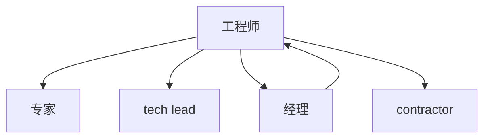

## Q
**Career path variants · 不止两条**｜摘要 · 加分

你觉得"工程师的路就是 IC 或者经理"。除了这两条，常见的职业路径还有哪些？

## A
**一句话：** 书里观察到至少十几种常见路径，大多数人的路径是组合，而且是非线性的。

| 路径 | 描述 |
|---|---|
| lifelong software engineer | 一直做工程师，越来越资深，换公司换栈 |
| specialist | 专精一个领域，比如 mobile、backend |
| generalist/specialist pendulum | 专精和通才来回摆 |
| niche field | 转 SRE、data engineer 之类，编码比例变小 |
| contractor/freelancer | Senior 之后做合同工，常常收入更高，稳定性更低 |
| tech lead | 带项目但不是管理 |
| engineering manager | 管理路线 |
| founder | 创业 |
| 转非工程岗位 | DevRel、PM、TPM、招聘等 |
| engineer/manager pendulum | 在管理和 IC 之间切换 |
| 组合与非线性 | 比如管理、长期休息、再回来 |

**怎么用：** 每年问自己：现在这一段对下一步有什么帮助？不必把某一条当成唯一正确的路。

**常见错法：** 认为必须一路向上；把中断或转向当成失败。

**出处：** Orosz《Guidebook》Ch.1 §2 "Common career paths"
