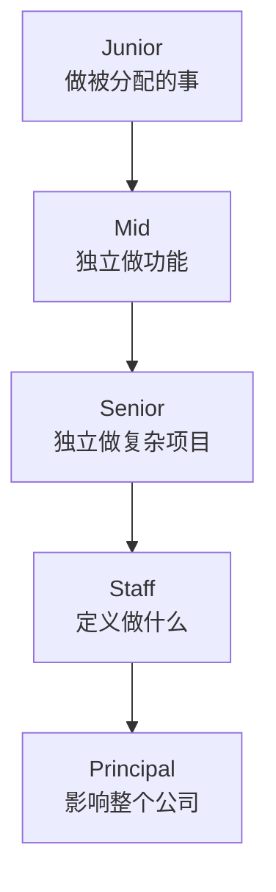

## Q
**Levels · IC 阶梯**｜摘要 · 必会

你拿到一份 offer，职位写 "Software Engineer II"。朋友说"这只是中间档"，但你完全不知道上面还有几层，每层到底差在哪。工程师的 level 是怎么排的？

## A
**一句话：** level 是公司给"期望"定的档位：越往上，要独立搞定的事越复杂，影响的人和业务越大。

IC（individual contributor，不带人、靠自己的技术产出的工程师）阶梯的典型形状：

**各家都在比的三个维度：**
| 维度 | 低 level | 高 level |
|---|---|---|
| scope（范围） | 一个任务、一个功能 | 一个系统、一个 org |
| autonomy（自主度） | 要人指路 | 自己定方向、自己解阻塞 |
| impact（影响） | 个人产出 | 带动他人，影响业务指标 |

- Senior 的底线是：能自主完成复杂项目，不需要别人看着。
- 很多公司的晋升在 Senior 之后明显变难，需要预算和空位（见晋升那几张卡）。
- Staff 以上的头衔各家叫法不同：有的叫 Staff，有的直接叫 Principal，有的叫 architect。

**所以怎么用：** 拿到 level 名字先别比较，先找这家公司的 ladder（职级说明）里该 level 的描述，对着三个维度看。

**出处：** Orosz《The Software Engineer's Guidebook》Ch.1 §2 "Typical Software Engineering Career Paths"；Part V 引言 "Role-Model Staff and Principal Engineers"；Ch.4 §1
