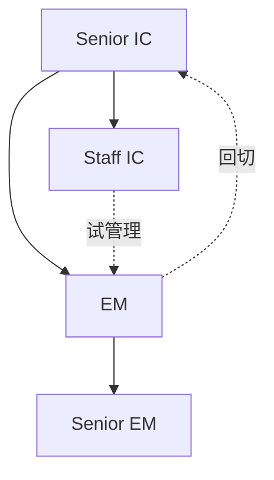

## Q
**IC vs manager track · 可回切**｜原则 · 必会

你是 Senior，经理说团队缺 EM（engineering manager，带团队的工程经理），问你要不要转。你怕转了回不来，也怕错过机会。怎么想？

## A
**原则：** 管理和 IC 是两条不同的路，不是升级与降级。很多公司允许来回切，书里称之为 engineer/manager pendulum（钟摆）。

**怎么做：**
1. 问公司是不是 dual-track（IC 与管理两条并行的阶梯）：engineering 超过大约 30 到 50 人，或比较成熟的公司通常有。没有的话，Staff 以后往上往往只能转管理。
2. 谈清楚回路。示例措辞："I'd like to try the EM role for a defined period. If it's not a fit, can we agree now that I can return to an IC role at my current level?"
3. 判断自己想要什么：管理的工作是人、优先级、沟通，写代码的时间会大幅减少。

**常见错法：**
- 因为"IC 升不上去"而转管理：工作内容完全不同，很多人转了才发现不喜欢。
- 不问回切的条件，出来之后找不到原来的位置。

**对方在想什么：** 经理想要的是稳定接手团队的人；公司也怕失去一个好工程师，所以回切通常有商量空间。

出处

Orosz《Guidebook》Ch.1 §2（Single-track、Dual-track、"Software engineer/manager pendulum"）

