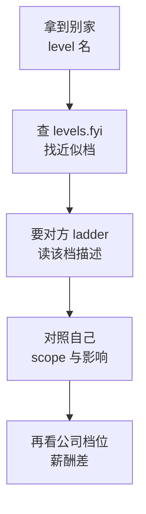

## Q
**Level mapping · 跨公司对照**｜原则 · 必会

招聘方说："我们的 Senior，大致相当于 Google 的 L5。" 你想判断这个 offer 是升了、平了还是降了。怎么对照？

## A
**原则：** levels.fyi（公开的职级与薪酬对照网站，用户自报数据）能给你起点，但它画的对照比现实整齐。真正的对照要看 scope，再看公司档位。

**怎么做：**
1. 查 levels.fyi 看这家公司完整的 level 序列，确认该 level 在第几层。
2. 向招聘方要职级说明："Could you share the leveling guide for this role, including the next level up?"
3. 比 scope 和 blast radius，不比头衔。
4. 书里的分档模型：同一岗位同一头衔，在不同类型的公司薪酬可差 2 到 4 倍，分三档：本地市场、本地顶端、地区或国际顶端。比 level 的同时要比档位。

**常见错法：**
- 把 levels.fyi 当事实：书里提醒，两个岗位的 scope 比网站展示的更难比较。
- 只比 level 不比公司档位：同一个 "Senior" 在大厂要求通常更高（见 down-level 的卡）。

**对方在想什么：** 招聘方的 level 是根据面试表现和 ladder 定的，不是根据你旧头衔。你给出可对照的事实，他们更容易给对档位。

出处

Orosz《Guidebook》Part V 引言（levels.fyi 及其局限）；Ch.1 §3 "Compensation and Tiers of Companies"

