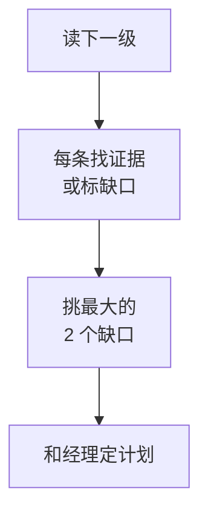

## Q
**Reading a public ladder · 找缺口**｜原则 · 追问

你在网上找到了公司公开的 career ladder（每个级别的期望说明）。你把每一条都对照了一遍，好像大部分已经"达到"。能不能说明你该升了？

## A
**原则：** 把 ladder 当诊断工具，找缺口，而不是打勾。大部分条目都"达到"并不等于被提名；评估的是下一级的 what（影响）和 how（能力）。

**怎么做：**
1. 对每个维度写下证据（链接、数据），写不出来的就是缺口。
2. 书里提醒：ladder 之外还有"实际如何运作"：有的公司要求先交付一个"promotion project"，同事评价的权重比文档写的低。去问走过流程的人。
3. 挑缺口最大的 2 个，设为下个周期的目标。
4. 示例措辞（对经理）："I reviewed the senior ladder and I think my gaps are in cross-team influence and written design. Can we pick a project in the next quarter to close those?"
5. 拿其他公司的公开 ladder（如 progression.fyi 里收集的）做对照，看你所在公司缺什么、多了什么。

**常见错法：** 全部打勾后直接找经理要晋升；只比 level 名字，不读期望。

**对方在想什么：** 经理希望你带来可讨论的具体项，而不是"我觉得我该升"。

**出处：** Orosz《Guidebook》Part V 引言（full career ladder 的重要性）；Ch.4 §1、§5（Understand how promotions *really* work）
