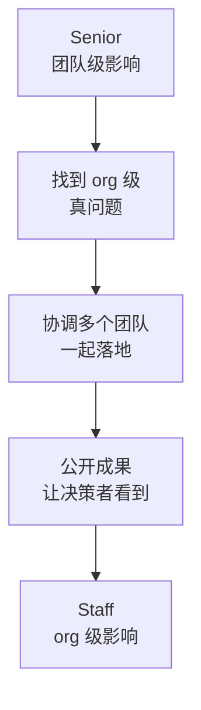

## Q
**Senior to Staff · 从做好到决定做什么**｜原则 · 必会

你是 Senior，交付稳定，评价也好，但两个周期都没升 Staff。经理说"再多一点 impact"。Senior 和 Staff 的真正分界是什么？你下一步怎么问？

## A
**原则：** Senior 是把给定的复杂问题做好；Staff 是在更大范围里决定该做哪些问题，并带着一群人把它做成。影响半径从团队变成 org 或公司。

**怎么做：**
1. 问清楚标准，用原句问经理："What would you need to see to support a staff bid? And is there room on this org for a staff role?" 在很多公司，Staff 以上要预算和空位，不是只看表现。
2. 让 skip-level（经理的经理）知道你的工作和影响。书里说 Staff 以上的晋升通常要他们的支持。
3. 工作重心从 produce（写代码、文档）转向 organize（拉起 initiative、改流程）和 publish（在会上、在 1:1（和经理或上级的固定一对一会谈）里讲清成果）。
4. 找一个比你高一级的人当 mentor。

**常见错法：**
- 只把现在的活干得更好：Senior 的上限就在这。
- 为了晋升专门造一套自研方案：书里把它叫 promotion-driven development，在能用现成方案时是浪费。

**对方在想什么：** 决策者问的是"如果没有这个人，org 会失去什么？"和"预算里有没有位置？"

**出处：** Orosz《Guidebook》Part V 引言；Ch.4 §1、§4（"promotion-driven development"）、§5（Produce, organize, publish；skip-level）
