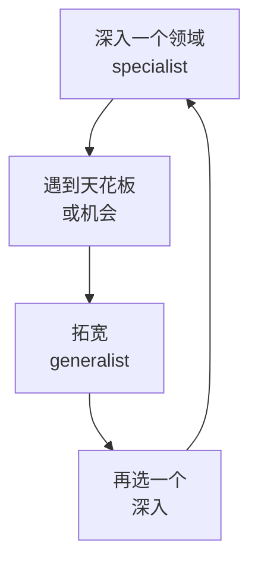

## Q
**Specialist vs generalist · 钟摆**｜原则 · 追问

你做了五年 mobile，被问"要不要成为 iOS 领域的专家，还是多学一点后端"。这两条路各自的代价是什么？

## A
**原则：** 两条路都是常见路径，而且可以来回摆：书里把"generalist/specialist pendulum"列为常见职业路径：先专精一项技术，再做一段时间的通才，反复。

| | specialist | generalist |
|---|---|---|
| 优势 | 在窄领域里稀缺，常被当 go-to person | 能带跨栈功能，能调试跨层问题 |
| 风险 | 领域被替代或变小 | 深度不足，面试时被问到深处 |

**怎么做：**
1. 书里的基础：先掌握一门语言和一个平台，再拓宽。
2. 每次选择问：三年后哪一类更稀缺、更有价值？
3. 做 full-stack 任务拓宽，不必换岗位。示例措辞："Could I take the backend part of this feature so I understand the full flow?"
4. 在简历里讲清"深"在哪里、"广"在哪里。

**常见错法：** 什么都学一点，没有一项能讲出深度；或者把自己锁在一个即将缩小的平台上。

**出处：** Orosz《Guidebook》Ch.1 §2（Generalist/specialist pendulum；software engineer turned specialist）；Ch.13 §1 "Languages, Platforms, and Domains"
