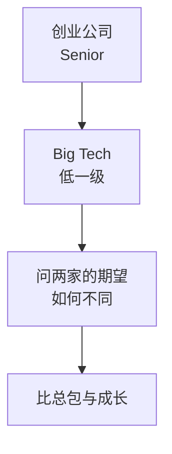

## Q
**Startup vs Big Tech levels · 同名不同价**｜考点 · 追问

你在创业公司是 Senior，面试 Big Tech 时 offer 是低一级的职位，但总薪酬更高。该觉得被"降级"吗？

## A
**原则：** 不一定。公司档位变了，期望也变了。书里说：升到更高档的公司，title 被砍而薪酬增加是常见情况。

**为什么会这样（书里列的）：**
- 往高档公司走：期望更高，但薪酬也更高。
- 同一个 senior 在大厂通常比在小型 agency 要求更多，影响的用户数不同。
- 面试表现：不确定的候选人常拿到低一级的 offer。
- 第一次进 Big Tech：onboarding 更长，团队想招能 raise the bar 的人，更常见降级。

**怎么做：**
1. 要对方的 level 定义和下一级的定义。
2. 比较总薪酬，不比 title。
3. 若觉得不对：用事实提出异议（见 negotiating level）。
4. 要看未来：下一次晋升到你原来 level 要多久、什么条件。

**常见错法：** 只看头衔；或者因为降级把一个总包更高、学习曲线更陡的机会拒掉。

**出处：** Orosz《Guidebook》Ch.6 §4 "Down-leveling"（moving up a tier）；Ch.1 §3；Ch.5 §4
