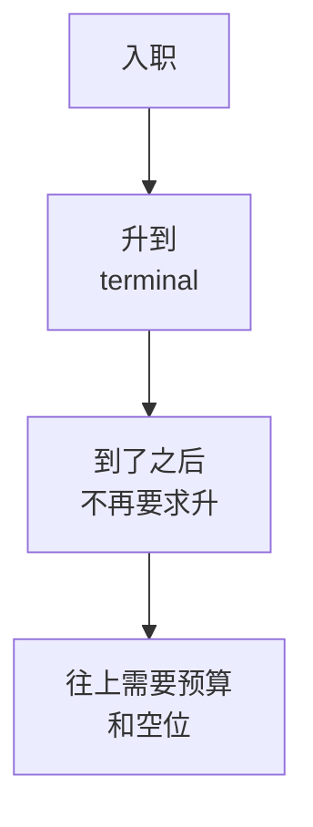

## Q
**Terminal level · 默认停在哪一级**｜摘要 · 追问

HR 说 "L5 is the terminal level on our ladder"。这是不是说你最多只能到 L5？它对 Senior 到 Staff 的路意味着什么？

## A
**一句话：** terminal level（也叫 career level）是公司期望每个工程师最终达到的级别，之后不再期望继续晋升。

**书里的事实：**
- 2015 年前后 terminal level 在 Google 是 L5，Meta 是 E5，Uber 是 L5A，都是 senior 级。没达到有时会被淘汰或进 PIP（performance improvement plan，绩效改进计划），也就是"升或走"（up or out）。
- 近年 Google 把 terminal level 降到 L4（Senior 之下一级）；Meta 和 Uber 也放松了对晋升的压力。
- 定义 terminal level 有两个目的：明确必须达到它；明确之后不保证晋升，因为更高级别需要预算。
- terminal level 的期望：完全自主、自己解除阻塞、帮团队成功并带初级工程师。

**怎么做：** 入职时问："Is there a terminal level here, and what does the company expect beyond it?" 如果有，Senior 之前的目标是明确的，之后要靠预算和空位。

**常见错法：** 把 terminal level 当作"天花板"；或者以为过了就不需要继续学习。

**出处：** Orosz《Guidebook》Ch.4 §3 "Terminal Level"
