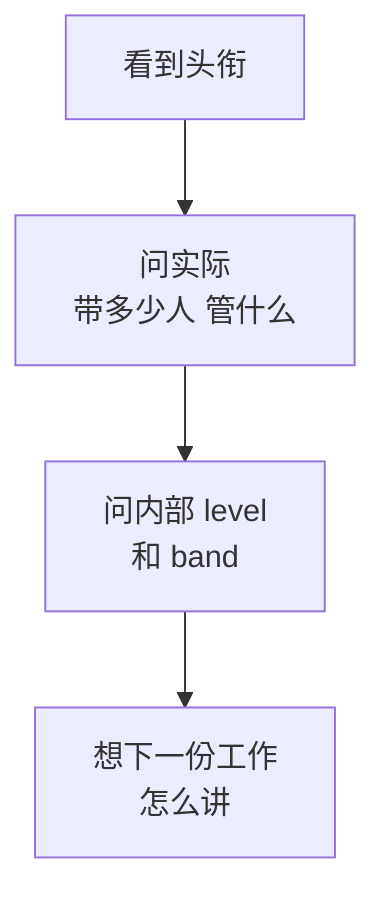

## Q
**Title vs level · 头衔通胀**｜原则 · 追问

一家 12 人的创业公司想给你 "Head of Engineering" 的头衔，薪酬却只有你现在 Senior 的水平。你该看重头衔吗？

## A
**原则：** title（对外显示的头衔）承载"合理的期望"，level（公司内部的职级，决定 band 和晋升）才决定薪酬与范围。小公司的头衔常常比实际范围大，换公司时对方只按你的 scope 判断。

**怎么做：**
1. 问清这个头衔对应的内容，示例措辞："What would my day-to-day scope be, how many engineers would I lead, and what level does this map to internally?"
2. 书里把 title 和 role 分开：title 带来对资历的合理期望；role 常是临时的（比如 project lead）。"Tech lead" 在有的公司是职级，在有的公司只是角色。
3. 下一份工作时，用事实描述："Led a team of four, owned the payments service"，而不是只写头衔。
4. 注意：换到大公司时，小公司的"大头衔"常会被按范围重新定级，可能比头衔低（见 Startup vs Big Tech levels）。

**常见错法：** 为头衔接受明显较低的薪酬；以为头衔会被下家按字面接受（书里：不同公司同一头衔期望差很多）。

**对方在想什么：** 小公司给头衔是便宜的福利，但也说明他们缺人手；你问清范围，反而让他们认真对待。

**出处：** Orosz《Guidebook》Ch.19 §1 "Roles and Titles"；Ch.1 §2；Part V 引言
