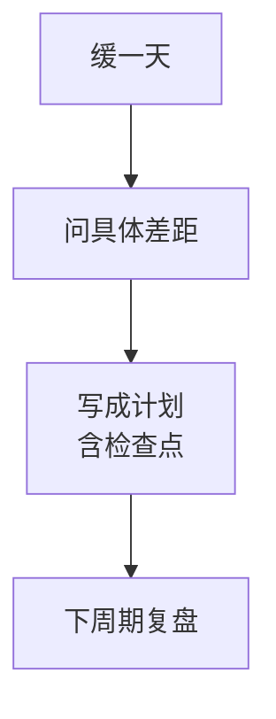

## Q
**After a rejection · 问清差距**｜原则 · 追问

晋升结果下来了：这次没过。经理说"下次再争取"。你很失望，也不知道缺什么。怎么处理这个时刻？

## A
**原则：** 情绪先放一天，然后把"为什么"问成具体差距，写成有时间的计划。书里说：大厂里申请晋升到 senior 级别，大约 30% 到 40% 的案子被驳回，没过不等于你不行。

**怎么做：**
1. 约经理的 1:1，用原句："Could you walk me through the feedback from the committee? Which specific gaps did they point to?"
2. 要具体的例子，不要"需要更多 leadership"这类含糊话。
3. 问："What would a successful case look like next cycle, and can we write that down together?"
4. 把计划写下来，设阶段性检查点，每个月对一次。
5. 同时评估外部选项（见 promotion by switching）。如果缺口属于"没有位置/预算"，那不是你能解决的。

**常见错法：** 当场争论；在同事面前抱怨；把它当作对自己价值的判决。书里的话：很可能十年后你都不记得这次周期。

**对方在想什么：** 经理希望你继续留下来，也怕你转身走。明确的计划让他有东西可以承诺。

**出处：** Orosz《Guidebook》Ch.4 §5（"about 30–40% of promotion cases to senior levels are rejected"；Prepare to not be promoted）；Ch.6 §2
