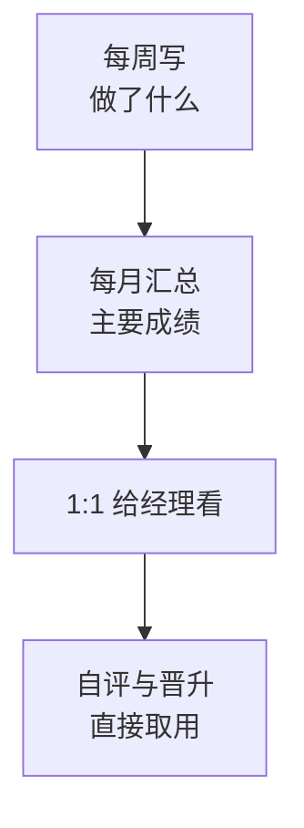

## Q
**Brag document · 持续记录**｜原则 · 必会

年底要写自评，你盯着屏幕想不起去年三月做过什么。只记得最近两个月的事。怎么避免每年都这样？

## A
**原则：** 每周花几分钟写一份 work log（也叫 brag document，把做过的事和成果持续记下来的文档），而不是年底回忆。

**每周记什么：** 重要的代码变更、code review、design doc、讨论与规划、帮别人的事、postmortem，只要花了时间并产生了影响。

**好处（书里列的）：**
- 知道自己的优先级，需要拒绝新活时，拿出清单说"要加这个，就得拿下一个"。
- 做完一天能放心下班，因为记下了完成的事。
- 自评和晋升材料的主要素材。
- 量化影响的证据。

**怎么做：**
1. 固定时间，比如每周五 10 分钟。
2. 每条写一行结果，不只写动作："Shipped retry logic; support tickets on failed payments dropped"（虚构）。
3. 每隔几周在 1:1 里给经理看。
4. 先坚持两个月再判断有没有用。

**常见错法：**
- 觉得是"吹嘘"所以不写：这是给自己和经理的事实记录。
- 只写大项目，漏了帮同事、写文档、救火。

**对方在想什么：** 经理没读你每个 PR。手里有现成的记录，他在校准会上替你说话就容易得多。

出处

Orosz《Guidebook》Ch.2 §3 "Keep a Work Log"（引 Julia Evans 的 brag document）；Ch.3 §2 "The Power of Habit"

