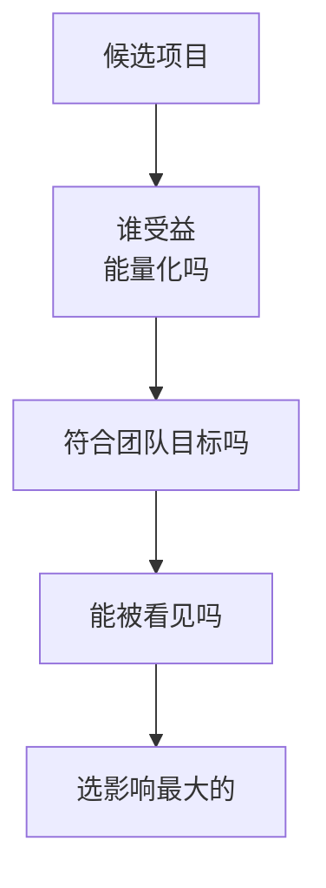

## Q
**Choosing promotable work · 避免忙而无功**｜原则 · 追问

你每周都加班，做了很多 bug fix、小重构和支持工作。年终评审却说"影响不够"。有两个新项目可选：一个是内部工具的清理，一个是支持公司本季度主要产品线的新功能。怎么选？

## A
**原则：** 书里区分：事情做完与做出有影响的事。晋升看的是"对业务和团队有影响的成果"，而不是任务数量。

**怎么做：**
1. 对每个候选项目问：影响谁、可以怎么度量、跟团队和公司的目标有多接近。
2. 产品功能通常比平台工作更容易量化；平台工作要用下一层 KPI（如延迟、可靠性）。
3. 对经理说："Which of these two would have more impact on the team's goals this quarter?"
4. 小的、必要的活也做，但控制比例。用 work log 看自己的分布。

**常见错法：** 为了"晋升"造一套本不需要的系统（promotion-driven development）；只做容易完成但没人在意的事；总是说"好"。

**对方在想什么：** 经理想把你放在能产出可见成绩的地方，也想你能多承担团队真正需要的。

**出处：** Orosz《Guidebook》Ch.2 §2 "Get plenty of *impactful* things done"；Ch.4 §4（product vs platform 的影响量化）、§5
