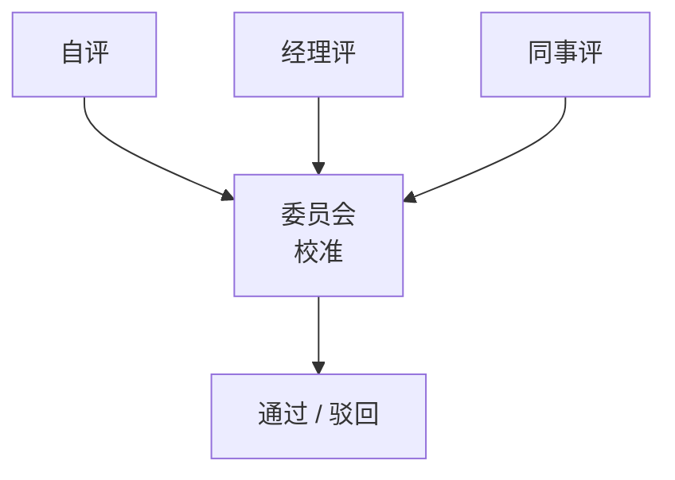

## Q
**Promotion process · 谁在决定**｜摘要 · 必会

你想知道"到底怎样才会被升"。同事说"表现好就行"，另一个同事说"看你的经理有没有面子"。两种说法为什么都有道理？

## A
**一句话：** 公司写的标准只是一半；另一半是谁来决定、用什么流程、你的工作被多少人看见。

书里按流程轻重分三类，各自偏爱的人不同：

| 流程 | 谁常见 | 怎么决定 | 对谁有利 |
|---|---|---|---|
| informal | 创业公司，大约 50 个工程师以内 | CTO 和几位经理开会当场定 | 和决策者常打交道的人 |
| lightweight | 中型公司；大公司 Senior 以前 | 经理提交一份简短理由，经理们开会 | 经理资历深、人脉广的人 |
| heavyweight | 大厂高级别 | 自评、经理评、同事评三份材料，再由委员会定 | 影响好量化、文字材料多、写得清楚的人 |

**calibration（校准）：** 多位经理把各自团队的评价放在同一把尺上对齐，防止有的经理给分偏松偏紧。

**还要知道：**
- 通常要在当前级别满 12 个月才有资格；有的公司要求评分在上半部分才能提名。
- 级别越高，越要有预算和空位。
- perception（别人怎么看你的影响）、有人支持、内部政治，都会进来。

**怎么做：** 先问两个问题："Who nominates, who decides?" 和 "What does the process reward, written evidence or manager advocacy?"

**常见错法：** 在 heavyweight 流程里只靠经理替你说话；在 informal 流程里闷头写文档不让决策者看到。

**出处：** Orosz《Guidebook》Ch.4 §1 "How Promotions Are Decided"、§2 "Types of Promotion Processes"、§4（12 个月资格）
