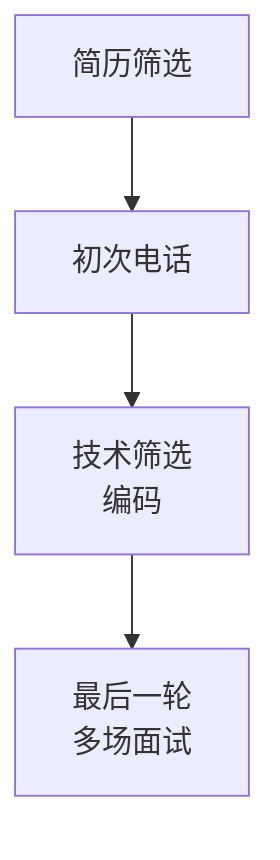

## Q
**Interview prep for switching jobs · 换岗要准备什么**｜摘要 · 加分

你在考虑通过换公司来升级。典型的 senior 级面试流程是什么样的？提前该把时间花在哪里？

## A
**一句话：** 书里描述的 "Google-like" 流程：初筛，技术筛选，最后一轮；初筛包括 resume 筛选和招聘方或 hiring manager 的电话。

**初筛看什么：** 基本资格、软技能、对流程的动力。

**怎么做：**
1. 简历：有针对性，讲你想让对方听到的故事，易扫读，用结果和数字，尽量通过推荐。
2. 初次电话：准备"为什么想换、想找什么"的清晰回答。
3. 技术筛选：保持编码手感，书里说同步编码是最常见形式之一。
4. 在职时面试也有价值：测市场价、保持面试手感、争取更高 level。
5. 面试技巧本身不在这个 deck 里；准备时去相应的 deck 里练。

**常见错法：** 每个岗位发同一份简历；面试前才开始准备；只在没压力时才去面。

**出处：** Orosz《Guidebook》Ch.6 §1、§3 "Preparing for Tech Interviews"
