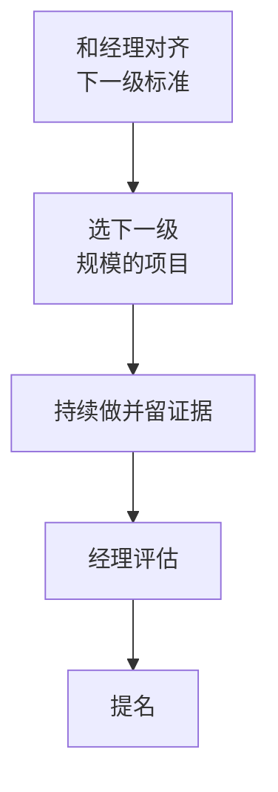

## Q
**Operating at the next level · 先做再升**｜原则 · 必会

你对经理说："我觉得我可以升 Senior 了，什么时候考虑我？" 经理说："你要先持续表现出 Senior 的水平。" 你觉得"先做再升"不公平。这个顺序合理吗？

## A
**原则：** 合理。晋升是回头看：确认你已经在下一级的水平上做了一段时间。书里说通常是 6 到 12 个月。

**怎么做：**
1. 自评：对照 ladder 看下一级的"what"（影响）和"how"（能力项）你已有哪些、缺哪些。
2. 请经理定书面的计划。示例措辞："Which projects would show next-level impact, and can we write down what 'ready' looks like before the next cycle?"
3. 向比你高一级的同事要反馈："Where do you see me operating at the next level, and what gaps do you see?"
4. 把活交给自己的项目：经理通常控制你做什么项目，没有对口项目就没有案子。

**常见错法：**
- 只做原岗位的事、期待年底自动升。
- 一心盯着晋升：书里提醒，被看成"只为晋升工作"会让经理和同事反感。
- 不问经理，直接去找 HR。

**对方在想什么：** 经理在想："我替他提名，委员会问起证据时我拿得出什么？" 你替他把证据备好，他的风险就小。

出处

Orosz《Guidebook》Ch.4 §5 "Advice for Getting Promoted"（plan in writing、peer feedback、"Be realistic"）；Ch.6 §2（promotions are backward-looking，6–12 个月）

