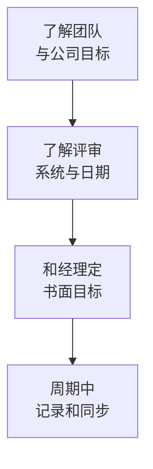

## Q
**Performance cycles & goals · 周期开始就定目标**｜原则 · 追问

年底评审时经理说："你这一年没怎么 own 大事。" 你觉得很冤，因为年初没人告诉你要怎样才算。怎么避免？

## A
**原则：** 在周期开始就了解什么重要、定下目标。书里说：start early。

**怎么做：**
1. 问经理团队目标与他的个人目标；问资深同事；听公司全员大会。
2. 弄清评审系统：书里列了四类：unstructured、manager-only、peer feedback、formal heavyweight。问谁最终决定、谁有主要输入、关键日期是什么。
3. 和经理商定目标，写下来："Can we agree on three goals for the half, and how we'll measure them?"
4. 每周在 work log 里记录，向经理同步。
5. 向资深同事请教"怎样做才公平"。

**常见错法：** 周期末才关注评审；只和经理对齐，忽略同事的输入；目标含糊没有衡量方式。

**对方在想什么：** 经理在评审里要为你辩护。越早有明确目标，他越有依据。

**出处：** Orosz《Guidebook》Ch.3 §1 "Start Early: Gather Context and Set Goals"、§2
