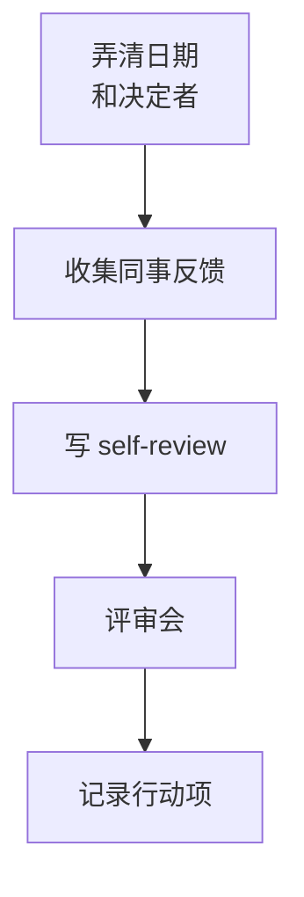

## Q
**Performance review mechanics · 评审前后**｜原则 · 追问

下周要交 self-review，并且要给同事写 peer feedback。你以前都是随便写几句。这次想认真做。具体怎么准备，评审会上怎么做？

## A
**原则：** 评审前把证据备齐，评审中听懂对方的标准，评审后写成行动。

**评审前：**
1. 确认关键日期和谁最终决定；评估你的经理能不能当你的 champion。
2. 向同事收集反馈。
3. 写自评，分成：what（长期成果，避免 recency bias，用 work log）、how（帮助他人、指导、务实决策等例子）、原目标与结果。

**评审会：**
1. 听反馈，不要当场辩解。示例："Thank you. Could you give me an example of when that happened?"
2. 要具体：书里的 decode 做法：要例子、问影响、要建议。
3. 如果不同意，解释理由，不必接受全部。
4. 以积极方式结束，约定后续。

**评审后：** 1 周内写下三条行动项发给经理确认。

**常见错法：** 只列任务；用同事的缺点来衬托自己；在评审会上发火。

出处

Orosz《Guidebook》Ch.3 §3 "Before the Performance Review"、§4；Ch.2 §4（decode 反馈）

