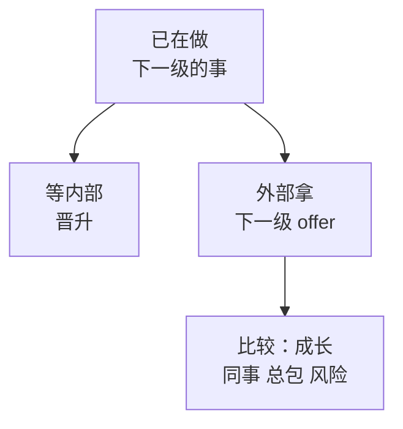

## Q
**Promotion by switching · 外部晋升**｜原则 · 追问

你觉得已经在做 Senior 的事，但公司下一轮晋升还要九个月。外面有公司愿意给 Senior。该等，还是跳？

## A
**原则：** 晋升是回头看，所以换公司有时能更快拿到下一级。但越资深，换公司风险越大。

**书里的判断点：**
- 早期职业：外部 offer 可以让你比内部流程更快升级。
- 越资深越冒险：Staff 以上要依靠政治信誉和对组织的理解，换公司要从头建立。
- tenure（任职时间）：Staff 以上，不到 2 到 3 年就换，会被视为红旗。
- 出发前想想你会放弃什么：大型平台和产品的成功要几年。
- 看 offer 不要只看钱：职业成长、同事、挑战、使命、灵活度。

**怎么做：**
1. 先和经理谈内部路径："Is there a realistic path to senior in the next two cycles?"
2. 同时面试，市场价是一个事实依据。
3. 拿到 offer 后再比较，看清 level 定义。
4. 如果走，好好离开（见 leaving well）。

**常见错法：** 用外部 offer 威胁；在不够 tenure 的情况下换；只比较头衔。

出处

Orosz《Guidebook》Ch.6 §2 "Waiting on a Promotion vs Switching Jobs"、§5 Up-Leveling

