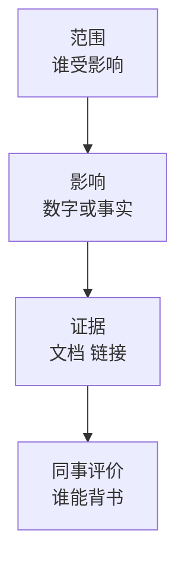

## Q
**Promotion packet · 结构**｜摘要 · 必会

你的经理说："晋升委员会下个月开会，你把你的 self-review 给我。"你从没写过。委员会要在里面看到什么？

## A
**一句话：** promotion packet（晋升材料）要让一群不认识你的人，只读文字就确信你已经在下一级运作。

大厂常要三份：自评、经理评、同事评。书里的评判框架分两个维度：

| 维度 | 问什么 | 材料里怎么写 |
|---|---|---|
| what | 影响有多大 | 范围、业务指标、有多少人受益 |
| how | 能力项（各公司的 competencies，如设计、执行、协作） | 带一个具体例子的叙述 |

**怎么做：**
1. 开头一段说清：下一级的标准是什么，你为什么已经达到。
2. 每条成绩写"做了什么、结果、谁受益"，能量化就量化。比如："Cut p99 checkout latency from 800 ms to 300 ms, benefiting all mobile users"（虚构示例）。
3. 附能被检查的链接：design doc、postmortem、里程碑。
4. 提前选好愿意写评价的同事，选比你高一级的。

**常见错法：**
- 只列任务清单，没有影响。
- 把"how"写成空话（"good collaborator"），没有例子。
- 到截止前才开始回忆。

**对方在想什么：** 委员会的人没时间猜。他们找的是已经被证据证明的下一级运作。

**出处：** Orosz《Guidebook》Ch.4 §2（heavyweight 流程的自评、经理评、同事评）；§4（"What" 与 "How"）；§5
