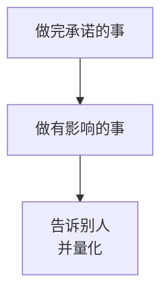

## Q
**Gets things done · 口碑**｜原则 · 追问

你的代码质量不错，但同事都不太记得你"做成过什么"。要建立"靠谱、会把事做成"的口碑，应该做哪几件事？

## A
**原则：** 书里把口碑拆成三步：把事做完、做有影响的事、让别人知道。

**怎么做：**
1. **做完：** 完成分到的工作，质量够好，节奏合理，能超预期就超。
2. **做有影响的：** 不是每个小重构，而是对业务和团队有意义的事。
3. **告诉别人：** 你交付了功能、完成了复杂项目，要告诉经理和团队，并量化业务影响。示例："The new retry flow went live Tuesday; failed payments dropped from X to Y."
4. 复杂或需要英雄式努力的事要说，否则别人看不到你的难处。

**常见错法：** 假设大家都知道你做了什么；只说"努力了"，不说结果；在大家面前夸大。

**对方在想什么：** 同事会按结果和可预测性判断你。准时、说到做到最能建立信任。

出处

Orosz《Guidebook》Ch.2 §2 "Be Seen as Someone Who Gets Things Done"

