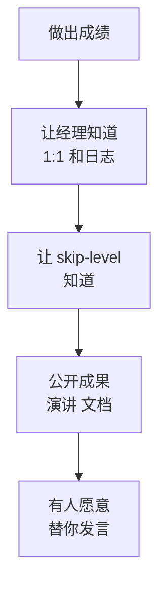

## Q
**Sponsors & visibility · 谁替你说话**｜原则 · 必会

校准会上，有人问起你的名字，在场的经理没一个知道你做过什么。你做了很多事，但没人替你发言。怎么提前补上？

## A
**原则：** 晋升要有决策者的支持，而你不在会议室里。要有人（sponsor，在你不在场的会议里替你发言并担保的人）熟悉你的工作，并愿意开口。

**怎么做：**
1. Tell, don't assume：主动告诉经理成果，不要以为他知道。
2. 约 skip-level 的 1:1，示例措辞："I'd like to share what I've been working on and get your view on where it could matter most."
3. 公开你的工作：在 org 的会议上讲，写能传阅的 design doc，做 knowledge-sharing。
4. 你自己也当别人的 sponsor：书里说，支持别人、帮助团队，会增加别人对你的善意。
5. 如果晋升会换经理，更要让 skip-level 全力支持。

**常见错法：**
- 只靠一个人替你说话：他一走，你的案子就断了。书里建议扩大可见度。
- 把"让人看见"当政治操作，完全不做。书里反复说，做得好但没人知道，等于没做。

**对方在想什么：** 替你发言的人是在拿自己的信誉担保。他需要具体事实和一个"这个人靠谱"的印象，才敢说话。

出处

Orosz《Guidebook》Ch.4 §5（skip-level、manager 变更时的可见度、"Help others so they help you"）；Ch.22 §6 Helping Others；Ch.2 §2 "Make sure people know you get stuff done"

