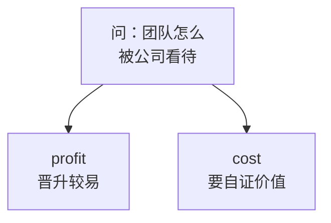

## Q
**Cost centers vs profit centers · 资源与天花板**｜考点 · 追问

你的两个候选团队：A 做直接带来收入的广告系统，B 做合规工程。薪酬相同。从长期职业角度，这两个团队的差别在哪？该怎么问？

## A
**原则：** 团队是 profit center 还是 cost center，会影响资源、晋升和裁员风险。

**书里的定义：**
- **profit center：** 直接产生收入的团队，比如广告组织。
- **cost center：** 不直接产生收入但公司运转必需，比如做 GDPR 合规的团队。

| | profit center | cost center |
|---|---|---|
| 晋升 | 几乎总是更容易，影响可以直接映射到收入 | 较难，要靠别的方式证明影响 |
| 绩效与 bonus | 到 senior 前差别通常不大；更高级别常常得分和奖金更好 | 较低 |
| 裁员 | 较稳 | 缩减时更容易被动 |

例外：大厂的 Staff 以上还要求解决组织范围的工程难题，所以这条规则不是绝对的。

**怎么问（原句）：**
- "How does the team's work connect to revenue or to a cost the company cares about?"
- "How is the team's headcount and budget decided?"

**常见错法：** 认为 cost center 一定不好：书里也说它们稳定、工作也重要，只是你要主动证明价值。

出处

Orosz《Guidebook》Ch.1 §4 "Cost Centers, Profit Centers"；Ch.5 §4（高增长公司裁员时 cost center 更易受影响）

