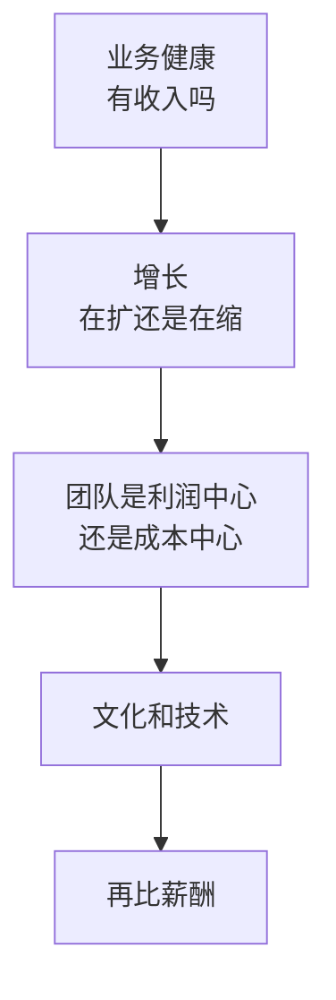

## Q
**Evaluating a company · 看什么**｜原则 · 必会

两家公司同时给你 offer：A 是上市大公司，B 是还在融资的公司，B 给的数字更高。除了薪酬，你要从哪些方面判断一家公司？

## A
**原则：** 薪酬只是最容易比较的一项。先判断公司会不会还在、值不值得待，再比其余。

**怎么做：**
1. **问业务：** "How does the company make money today, and is this team close to that revenue?" 利润中心（直接产生收入的团队）通常比成本中心（支撑业务但不产生收入的团队，比如合规）更容易晋升，裁员时也更安全。
2. **问资金：** 私有公司问最近一轮融资时间和 runway（现金还能撑多久）。"When was the last funding round, and how many months of runway does the company plan for?"
3. **问增长：** 招人是在加速还是冻结？最近有没有裁员或领导层变动？书里说裁员、更严的绩效、换领导，是公司进入 wartime（生存模式）的信号。
4. **问文化和技术：** 谁决定做什么、on-call（轮值处理线上故障）多不多、技术栈和工程实践如何。
5. **把非薪酬因素写下来打分：** 同事、经理、成长机会、灵活度、on-call 压力、使命。书里说很多长期从业者会为了这些里的一项接受少赚。

**常见错法：**
- 只比总包。
- 只看公司名气，不看团队在公司里的位置。
- 不问钱从哪来就接受私有公司的股权。

**对方在想什么：** 招聘方愿意回答这些问题，你问得具体，他们会觉得你认真。回避的公司本身就是信号。

出处

Orosz《Guidebook》Ch.1 §1、§4 "Cost Centers, Profit Centers"、§5；Ch.5 §3–§4；Ch.6 §1

