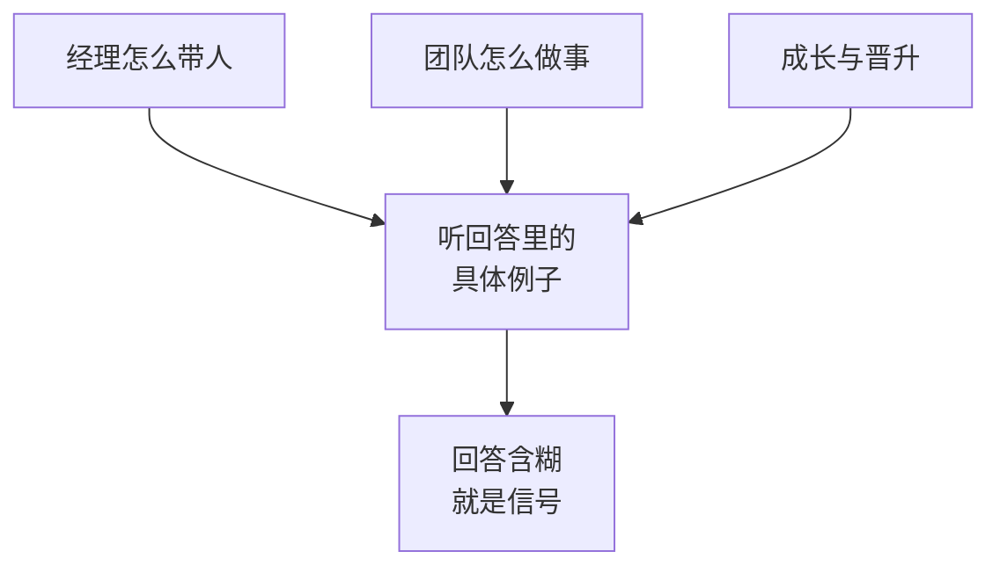

## Q
**Evaluating a team & manager · 面试时反问**｜原则 · 必会

面试最后，对方说："你有什么要问我们的吗？" 你想借这个机会判断团队和经理，但不想显得在审问人。问什么？

## A
**原则：** 经理是你在公司里影响最大的一个关系。反问环节是你评估他的机会，问具体做法，不问"文化好不好"。

**可以这么问（原句）：**
- 带人："How often do you have 1:1s with your reports, and what do they usually cover?"
- 反馈："Can you give an example of how someone on the team got feedback on a hard project?"
- 成长："How have engineers on this team been promoted in the last two years?"
- 团队运作："What does on-call look like, and how many incidents did the team have last quarter?"
- 方向："What's the biggest challenge the team faces over the next six months?"
- 如果是 product 团队还是 platform 团队（做内部工具和基础设施的团队）：问清团队服务谁，成功用什么衡量。

**常见错法：**
- 只问"团队氛围怎么样"：对方会说"很好"。
- 一个问题也不问：对方会觉得你不在意。
- 只问经理，不问将来的同事。条件允许就和团队里的工程师聊一次。

**对方在想什么：** 好经理愿意详细回答带人的问题。如果他讲不出具体例子，或回避"最近有人为什么离职"，这就是信息。

**出处：** Orosz《Guidebook》Ch.6 §1 "Exploring New Opportunities"；Ch.5 §1 Product Teams、§2 Platform Teams；Ch.2 §5（经理是影响最大的同事关系）
