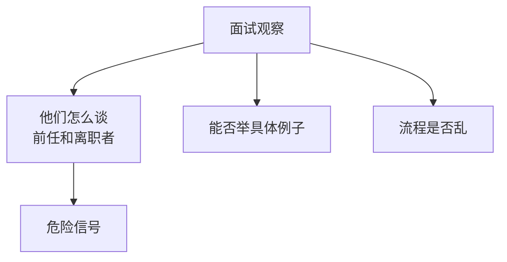

## Q
**Green & red flags · 面试中能观察到什么**｜摘要 · 追问

四轮面试下来，你觉得"哪里不对劲"，但说不清楚。面试过程中有哪些具体的信号可以用来判断一个团队健不健康？

## A
**一句话：** 看团队怎么回答具体问题，以及书里描述的 unhealthy teams 的症状有没有出现在他们的描述里。

| | green flag | red flag |
|---|---|---|
| 经理 | 能讲出具体的带人和反馈例子 | 回避"为什么上一位走了" |
| 流程 | 面试安排清楚，及时反馈 | 反复改时间，没人回复 |
| 团队 | 能说出近期成果和下一步 | 描述全是"我们很忙" |
| 公司状态 | 领导层稳定，招人有节奏 | 频繁换领导、刚裁员、绩效突然变严（wartime 信号） |
| 工作 | 清楚的 on-call、责任划分 | 角色模糊，没人负责 |

**可以问（原句）：**
- "Why is this role open?"
- "What happened to the previous person in this position?"
- "How many engineers have left the team in the last year?"

**常见错法：** 一个信号就下结论（可能是个别情况）；忽略自己的直觉，只看薪酬。

**出处：** Orosz《Guidebook》Ch.6 §1；Ch.20 §2 "Unhealthy Teams"；Ch.5 §4（wartime 信号）。上表中的具体问法是练习建议
