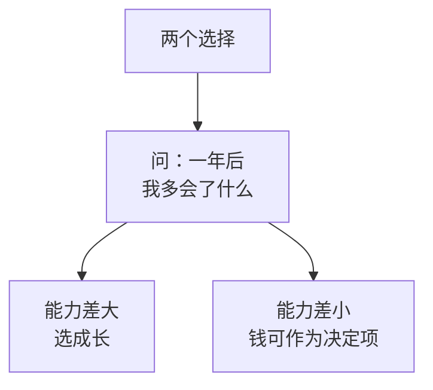

## Q
**Learning vs earning · 早期优先成长**｜原则 · 必会

你工作两年，手里有两个选择：A 公司比现在多给一些钱，但做的是维护旧系统；B 公司钱和现在差不多，但会让你负责一个新服务、有强的 senior 带你。选哪个？

## A
**原则：** 薪酬是最好量化的一项，但不是唯一重要的。早期职业里，学习曲线通常比当下差的那点钱更值钱。

**怎么做：**
1. 把每个选择写成"一年后我能做什么、手里有什么可以讲的项目"。
2. 看书里 §5 的清单：同事、经理、成长机会、灵活度、on-call、使命，给每项打分。
3. 书里用两个人做对比：Engineer A 追求最快的头衔，到了 Staff 就卡住；Engineer B 追随好奇心，换技术栈、有时降一级，后来凭广度和深度脱颖而出。很多投资要很久才回报。
4. 如果你有硬性经济压力，把钱放在前面是合理的，这里没有标准答案。

**常见错法：**
- 把"年薪多一点"当成唯一尺度。
- 把"学习"当成一句口号：必须能说出具体学什么、谁带你。

**对方在想什么：** 招聘方会看你的履历有没有成长轨迹。能讲出"这几年我在学什么"，比只讲涨薪更有说服力。

**出处：** Orosz《Guidebook》Ch.1 §5 "Alternative Ways to Think About Career Progress"；Ch.4 §6 "Many career investments only pay off much later"；Ch.26 §3
