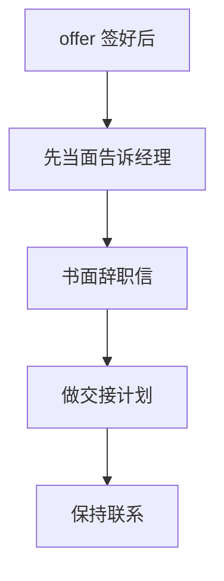

## Q
**Leaving well · 好好告别**｜原则 · 追问

你拿到了新 offer，准备离职。你怕经理生气，也怕被同事认为不负责任。怎么离开才不伤关系？

## A
**原则：** 圈子很小，书里说"人们记得谁推过他们"。你留下的印象会在多年后回来，所以交接做好，当面告知，保持感谢。

**怎么做：**
1. 先告诉经理，不是群里公布。示例措辞："I wanted you to be the first to know. I've accepted an offer elsewhere, and my last day will be X. I've really valued working with you, and I want to make the transition as smooth as possible."
2. 简短、正向的辞职信，不写抱怨。
3. 主动提交交接清单：进行中的项目、文档、联系人。
4. 对于 counteroffer（见相关卡）想好答案再进会。
5. exit interview 中说事实，避免点名攻击。
6. 离开后保持联系：同事和经理将来可能是推荐人、合作者。

**常见错法：** 提前在同事里散播；离职前一周完全不交付；在 exit interview 里发泄。

**对方在想什么：** 经理最担心的是项目被打断和团队士气。你给出时间表和交接，等于替他回答这两个问题。

出处

Orosz《Guidebook》Ch.4 §6（avoid elbowing people，tech industry feels small）；HBR https://hbr.org/2021/07/yes-you-can-quit-your-job-without-burning-a-bridge（页面正文需订阅，仅见摘要：担心损害关系、推荐人、善意）。措辞为练习示例

