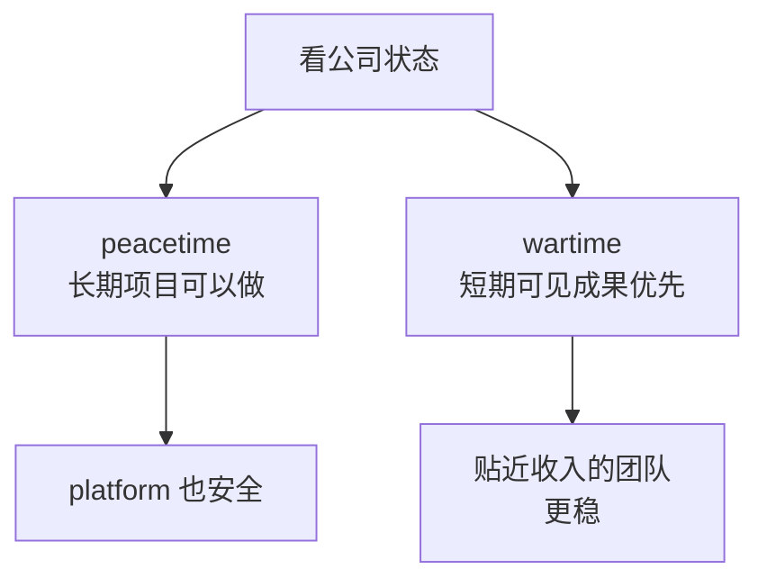

## Q
**Product vs platform, peacetime vs wartime · 团队与状态**｜考点 · 追问

你在两个团队间选：一个是做面向用户功能的 product 团队，一个是做内部基础设施的 platform 团队。公司最近在裁员、领导层换人。这两个因素怎么影响你的选择和晋升打法？

## A
**定义（书里）：**
- **product 团队：** 做面向客户的产品，影响容易量化到收入或用户指标。
- **platform 团队：** 为其他工程团队提供基础设施和工具；影响常用延迟、可靠性等下一层 KPI 衡量。
- **peacetime：** 公司相对领先、市场在增长，可以做长期的事。
- **wartime：** 公司在对抗迫在眉睫的生存威胁；信号：裁员、更严的绩效评审、领导层变动。

**怎么做：**
1. 公司规模：大公司的 platform 团队常见（书里：最多约四分之一的工程师）；scaleup 里 platform 团队往往刚起步；startup 几乎没有。
2. wartime 时：把工作和公司当前的存亡指标对齐，并更频繁地让人看到成果。
3. platform 团队的晋升案例要把影响翻译成对 product 团队的价值："Our change cut deploy time for 40 teams from X to Y"（示例）。
4. 面试时问："Would you describe the company as in steady mode or a push right now?"

**常见错法：** 在 wartime 里做看不到短期价值的长线项目；把 platform 当成"安全"，忽略成本中心风险。

**出处：** Orosz《Guidebook》Ch.5 §1–§3 "Product Teams / Platform Teams / Peacetime vs Wartime"、§4；Ch.4 §4
