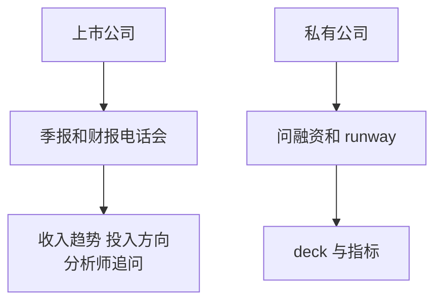

## Q
**Reading company finances · 阶段、跑道、估值信号**｜摘要 · 追问

你在考虑两家公司：一家是上市公司，一家是私有的 Series C 公司。你想在接 offer 前，弄明白它们的财务健康程度。去哪里看什么？

## A
**一句话：** 上市公司有强制披露；私有公司没有，要靠提问和内部透明度。

**上市公司（书里）：**
- 每季度有财报和 earnings call（财报电话会）。
- 看四类信息：收入和盈利趋势；领导层强调哪些产品和团队；分析师问的敏感问题和回答质量；前瞻性目标（收入、成本削减）对你所在团队的影响。
- 学会读 revenue、cash flow、EBITDA（息税折旧摊销前利润）等词。

**私有公司（书里）：**
- 内部透明度通常更高：问业务指标、增长点、挑战。
- 能见到创始人时，问他们对业务和投资人的看法。
- 公司在融资时，问能否看 pitch deck。

**面试时可以问（原句）：**
- "When was the last funding round, and how many months of runway does the company plan for?"
- "How is revenue trending, and is the team I'd join tied to it?"

**常见错法：** 只看融资额和估值标题；把"独角兽"（估值 $1B 以上的私有公司）当作质量标志，书里说现在已不少见。

**出处：** Orosz《Guidebook》Ch.21 §4 "Public Companies"、§5 "Startups"；Ch.1 §1（unicorn 含义）
