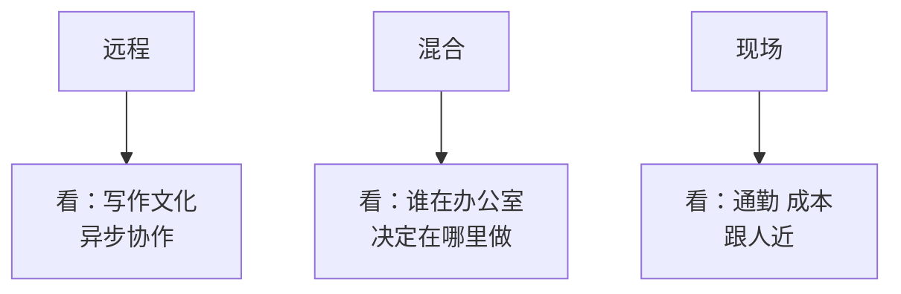

## Q
**Remote, hybrid & location · 选工作方式**｜原则 · 追问

两份 offer：一份是 fully remote，另一份是每周 3 天去办公室、但团队在你喜欢的城市。除了通勤和薪酬，要问什么才能判断哪个对你的职业更好？

## A
**原则：** 工作方式是职业选择的一部分：影响学习、可见度、薪酬与生活。书里把"灵活度"放进了衡量一份工作的清单。

**要问的（原句）：**
- "How does the team make decisions: in meetings, or in written docs?"
- "Are there people in the leadership chain who are fully remote?"
- "Is promotion and project assignment the same for remote and in-office employees?"
- "How is compensation set, does it vary by location?"

**要想的：**
1. GitLab 的 handbook 提供了成熟的 all-remote 做法。它的标题涉及异步、写作优先、会议规范，也有专门页面讲 all-remote 的缺点，比如孤立和倦怠。可见这是一套要刻意经营的工作方式。
2. hybrid 最大的风险：办公室里的人容易获得非正式信息和机会，远程的人被忽略。
3. 位置会影响薪酬 band，见 bands & geo adjustments。

**常见错法：** 只问"能不能远程"，不问晋升和项目机会是否一样；把 remote 当作"没有协作"。

出处

GitLab Handbook https://handbook.gitlab.com/handbook/company/culture/all-remote/guide/（页面标题与目录，2026-11-21 读取；正文未全读）；Orosz《Guidebook》Ch.1 §5（Flexibility 作为衡量项）

