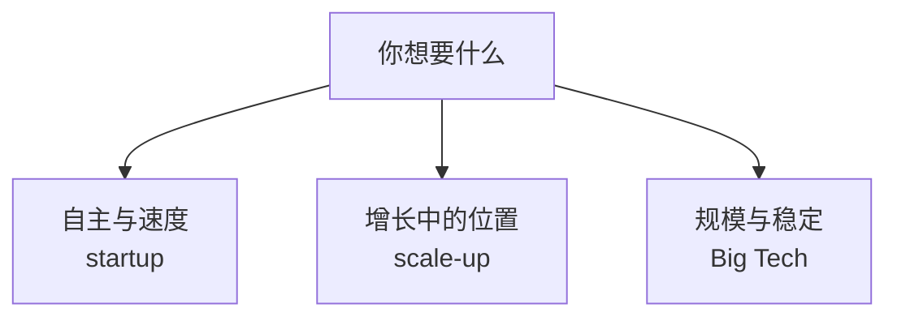

## Q
**Startup vs scale-up vs Big Tech · 对比**｜摘要 · 必会

你同时面了一家 early-stage startup、一家 Series C 的 scale-up 和一家 Big Tech。朋友说"大厂稳、创业公司刺激"。这样粗略的分法漏掉了什么？

## A
**一句话：** 三类公司的风险、自主度、晋升方式和工作节奏不同；书里按 product/platform 团队占比、peacetime/wartime 状态来区分。

| | early-stage startup | scale-up | Big Tech |
|---|---|---|---|
| 阶段 | 找 product-market fit（产品有没有真实客户需求） | Series B、C、D 或更后，未上市 | 大型上市公司 |
| 团队类型 | 几乎全是 product 团队 | 绝大多数是 product 团队 | 投入大量 platform 团队，最多约四分之一工程师 |
| 状态 | 多半 wartime（生存模式） | 常见 wartime | 多半 peacetime（平稳），偶尔切 wartime |
| 自主度 | 很高，先做再说 | 较高 | 流程重 |
| 风险 | 最容易裁员和倒闭 | 增长放缓时会裁员 | 较低，但绩效和晋升流程重 |
| 要做什么 | 帮公司拿到 product-market fit，尽快交付 | 参与 hiring 和 onboarding，经验价值高 | 记录个人影响，建立人脉 |

**怎么做：** 先问自己想学什么，再对表。面试时问："Would you describe the company as in a growth push or steady mode right now?"

**常见错法：** 只用公司名气判断；只看股权的潜在大回报，忽略股权不能马上变现。

**出处：** Orosz《Guidebook》Ch.1 §1 "Types of Companies"；Ch.5 §3 "Peacetime vs Wartime"、§4 "Types of Companies"
