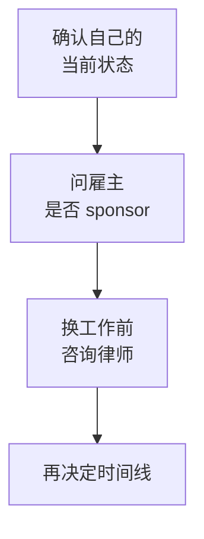

## Q
**Visa & immigration constraints · 对选择的影响**｜原则 · 追问

你需要雇主 sponsor 工作签证。面试时 recruiter 问你"Do you require sponsorship now or in the future?" 你应该怎么理解这个问题，它怎样影响你选公司？（以下只是通用规则，不是法律建议，具体情况请咨询移民律师。）

## A
**原则：** 签证状态是选雇主的硬约束之一：它决定你能考虑哪些公司，也决定换工作时的难度。

**美国 USCIS 页面的通用说法（页面未标日期，2026-11-21 读取）：**
- 临时工作者（nonimmigrant）：常见途径是雇主向 USCIS 提交申请（petition）。
- 永久工作者：有五类 employment-based immigrant visa preference。
- 身在国外：通常需要国务院签发的签证，另外要在入境口岸被 CBP 官员放行。
- 已在美国：可能转换到有工作许可的 nonimmigrant status，或调整为永久居民；某些类别可以自行申请；可用 Form I-765 申请工作许可。
- 违反就业授权或入境条件，可能被遣返或拒绝再入境。
- 这个页面没有讲更换雇主的细节。

**怎么做：**
1. 一开始就诚实回答："Yes, I'll need sponsorship. Could you tell me whether the company sponsors, and for which roles?"
2. 比较 offer 时把"是否 sponsor、是否支持转换、是否有律师支持"当成条件。
3. 换工作和空档期会影响状态，具体规则因类别而异，必须由移民律师确认。

**常见错法：** 为了避免被拒而隐瞒；只看薪酬不看 sponsor 政策；不核实就依赖朋友的经验（个案不同）。

**出处：** USCIS https://www.uscis.gov/working-in-the-united-states（2026-11-21 读取，页面无日期）。一般性信息，不构成法律建议
