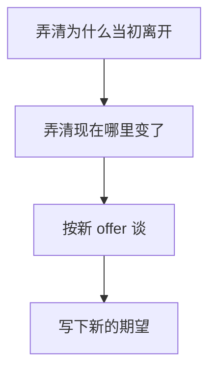

## Q
**Boomerang & re-entry · 回到老东家**｜原则 · 加分

两年前你离开了公司 A，现在以前的经理联系你，问要不要回来。你该怎么考虑，怎么谈？

## A
**原则：** 回去的好处是信任和上手速度，风险是"回去就是原来的位置"。把它当成一份新 offer 来谈。

**HBR 页面可见的三个问题：** 怎么回到团队里；是不是接着当初的位置；对别人怎么解释为什么走、为什么回。

**怎么做：**
1. 当初离开的原因现在还在吗？问经理："What has changed on the team since I left, and what would my scope be?"
2. 你有外部经历，常常比同级留任者更有价值，按新的市场价格谈；原先的工资不是上限。示例："Given the experience I've gained, I'd like to discuss a level and package that reflects that."
3. 从一开始约定新的期望，不要默认回到旧角色。
4. 对旧同事坦诚、谦虚：你不在时发生了变化。

**常见错法：** 假设一切照旧；用"这里我熟"当理由跳过提问；对离职后留下的同事摆出"我见过更好的"的态度。

**对方在想什么：** 公司想用熟悉的人降低招聘风险。这是你的筹码，但也要避免让现有员工觉得不公平。

**出处：** HBR https://hbr.org/2017/08/what-to-do-when-youre-returning-to-a-company-you-used-to-work-for（正文需订阅，仅见摘要中的三个问题）。其余为通用做法示例
