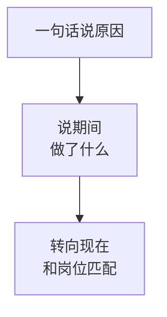

## Q
**Career gaps · 怎么解释空档**｜原则 · 追问

你因为照顾家人，有一年没工作。面试官问："Can you walk me through this period on your resume?" 你该怎么答？

## A
**原则：** 主动、简短、平静地说明，然后转向你现在能做什么。HBR 页面的摘要：雇主在疫情后对空档更宽容，但你仍要清楚自信地解释；不解释就失去了塑造他人理解的机会。

**可以这么说（原句）：**
1. "I took about a year away from work to care for a family member. I'm now ready to return full time."
2. "During that period I kept my skills current by working on X and finishing Y."
3. "That's behind me now, and I'm looking for a role where I can apply Z."
4. 因为被裁员："My role was eliminated in a restructuring. Since then I've been strengthening my skills in X and looking for a long-term fit."

**别这么说：**
- 过度道歉或长篇解释隐私。
- 编造一段不存在的"咨询"。被查到会失信。

**要做的准备：**
1. 空档期间保持动手：小项目、课程、开源。
2. 联系旧同事，请他们帮你介绍。书里说非线性路径很常见，其中有人休了很长的假后回来做 director。

**语气：** 事实、平静、向前看。

出处

HBR https://hbr.org/2023/06/how-to-explain-a-gap-in-your-resume（仅见摘要）；Orosz《Guidebook》Ch.1 §2（non-linear career path）。示例措辞为本卡编写，不是 HBR 原句

