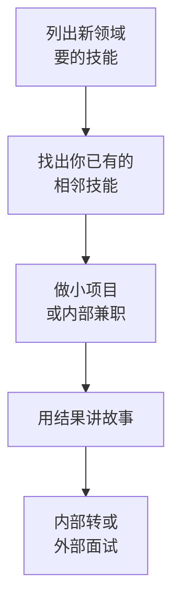

## Q
**Changing domains · 用相邻技能搭桥**｜原则 · 必会

你做了四年电商后端，想转去 payments 或 data infrastructure 这类完全不同的业务领域。招聘方说"我们想要有这个领域经验的人"。怎么办？

## A
**原则：** 领域经验是招聘方降低风险的捷径，但不是硬门槛。用相邻技能搭桥，再用小项目证明你能学。

**怎么做：**
1. 拆新领域需要的技能：比如 payments 看重正确性、幂等、对账。
2. 对照你已有的：电商订单系统里处理过重试和幂等，就是相邻技能。
3. 做一个小项目证明：在现公司主动接一个和新领域有交集的任务，或做可公开的小项目。
4. 面试用原句讲："I haven't worked in payments directly, but in my last role I owned an order service where idempotency and reconciliation were central."
5. 书里说，学会第二种、第三种语言和平台后更容易学新的：广度本身就是资产。

**常见错法：**
- 把"我想转"当成理由，不说你已有什么。
- 一上来就要求更高 level：领域转换常常意味着在新领域里相对更初级。

**对方在想什么：** 招聘方在算"这个人要多久能独立"。你用相邻技能和小项目缩短这个估算。

**出处：** Orosz《Guidebook》Ch.1 §2（generalist/specialist pendulum；engineer who changes domains）；Ch.13 §1 "Languages, Platforms, and Domains"
