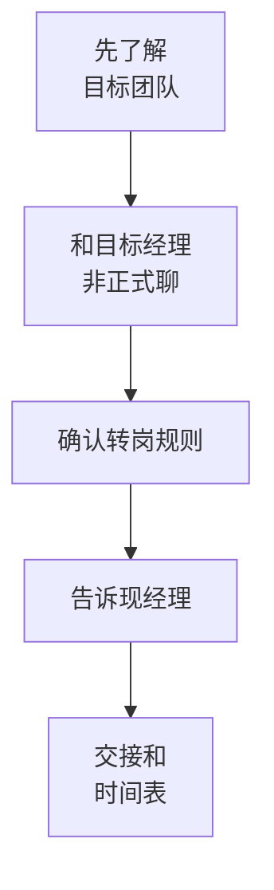

## Q
**Internal transfer · 时机与开口**｜原则 · 必会

你想转去公司里另一个团队，但担心经理觉得你在背叛他。什么时候、怎么开口最稳妥？

## A
**原则：** 内部转岗通常是最便宜的换环境方式：你的信誉和人脉都带着走。关键是时机和信息顺序，不让经理从别人嘴里听说。

**怎么做：**
1. 先查规则：很多公司要求在当前团队待满一定时间、近期评分不差，才能转。问 HR 或看内部 wiki。
2. 先和目标团队的经理或工程师非正式聊聊，了解真实情况，不急着申请。
3. 再对现经理说。示例措辞："I've really valued working with you. I'm interested in moving into X because I want to build experience in Y. I'd like to plan it so the handoff is smooth for the team."
4. 给出交接计划和时间点，把你负责的事留好。
5. 如果你的不满是经理或团队本身，书里把"内部转岗不可行"列为外部找工作的理由之一，所以先验证内部有没有出路。

**常见错法：**
- 先去面目标团队，后通知现经理。
- 把理由说成"这里不行"，而不是"我想获得 Y 的经验"。
- 在评分刚出来不好的时候提转岗。

**对方在想什么：** 现经理担心空档和你离开的信号；目标经理想知道你是不是在逃离问题。你用交接计划和明确的目标回答这两个担心。

出处

Orosz《Guidebook》Ch.6 §1 "Exploring New Opportunities"（internal moves 作为替代；不满意时的选项）；Ch.5 §4（高速增长公司里内部转岗的机会）；转岗流程部分为通用做法，各公司规则不同

