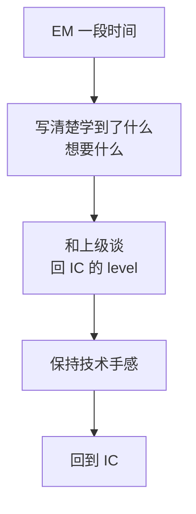

## Q
**Moving to management and back · 来回切**｜原则 · 追问

你做了 18 个月 EM，发现自己更想写代码、做技术决策。想回 IC，但怕被认为"管理失败"。怎么回，怎么讲？

## A
**原则：** engineer/manager pendulum（工程师和经理之间的钟摆）很常见：书里说在 dual-track 公司，在两条线之间来回比人们想象的更普遍。

**怎么做：**
1. 把原因说成"我想把精力放在 X"，不是"我不行"。示例措辞："I've learned a lot as a manager, and I realized I get the most energy from solving hard technical problems. I'd like to move back to a senior IC role."
2. 先谈 level：回 IC 时通常对应你管理前后的技术级别，具体要和上级商定，最好在转管理时就谈好回路。
3. 管理期间保持动手：做设计评审、小功能，不要把技术手感丢光。
4. 把管理经验写成 IC 的价值：能带项目、懂业务、跨团队协调。

**常见错法：** 拖到被迫离开才提；只说"不喜欢管人"；管理期间完全不碰代码，回来时面试吃亏。

**对方在想什么：** 上级担心你是不是逃避，也担心团队空缺。你给出清楚的交接和未来贡献，他更愿意支持。

出处

Orosz《Guidebook》Ch.1 §2（Software engineer/manager pendulum；Switch between IC and manager tracks）

