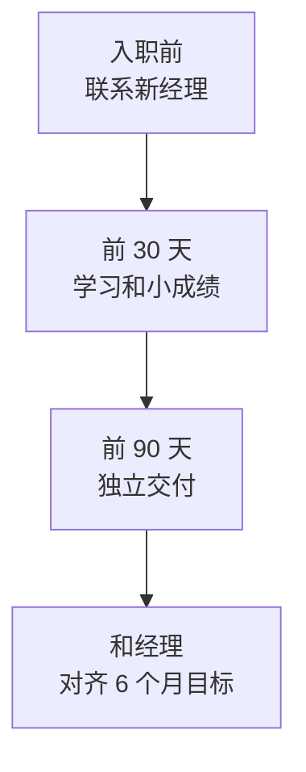

## Q
**Onboarding to a new job · 头几周站稳**｜原则 · 追问

你下周入职一家大公司，官方的 onboarding 很松散。你希望三个月后被看作"hits the ground running"的人。这几周要主动做什么？

## A
**原则：** 别人对你的印象在头几个月形成，而且常常持续多年。你自己主导 onboarding，不要等别人安排。

**所有公司通用（书里）：**
- 入职前如果有较长通知期，联系新经理问如何准备。
- 从第一天开始写 work log，和每周日记：三件学会的事、三件没搞懂的事。
- 和经理对齐第一个月、前三个月、前六个月的目标。

**大公司：**
- 找 onboarding buddy，没有分配也自己找一位。
- 记一份 cheat sheet：缩写、构建命令、重要链接。

**小公司：**
- 入职前就问清要做的事。
- 尽早认识最资深的人，不要假设事情怎么运作，直接问。
- 第一周就交付点东西。

**示例措辞：** "To plan my first 90 days, could we agree on what success looks like at 30, 60 and 90 days?"

**常见错法：** 等人来教；一上来就批评"我们以前不这样做"；不记录学到什么。

**出处：** Orosz《Guidebook》Ch.6 §6 "Onboarding to a New Job"
