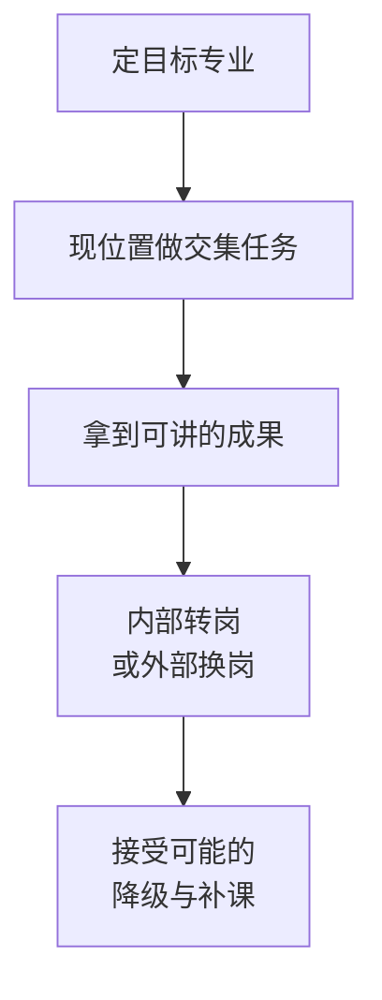

## Q
**Pivoting specialties · 通用步骤**｜原则 · 必会

你是 frontend 工程师，想转成 backend 或 SRE（专门保障线上系统可靠性的工程师）。从哪里开始，怎样不把职业生涯清零？

## A
**原则：** 转专业是一个计划好的过渡，不是一次跳崖：先在现位置做出交集，再换岗位，再补齐。

**怎么做：**
1. 选一个目标，写出"3 个月后我要有什么可展示的成果"。
2. 在现位置找交集：frontend 想转 backend，就主动做一个全栈功能，参与 API 设计。书里说，现实中功能常常横跨前后端，了解相邻栈会让你能带全栈功能。
3. 向目标领域的人请教，要一位愿意带你的 mentor。
4. 切换时接受可能的降级（见 down-leveling 那张卡），换来更宽的技能。
5. 书里的 Engineer B 就是反复这样做：每次换栈都可能先降一级，长远回报更大。

**常见错法：**
- 同时换公司、换专业、换领域三件事。变量太多，失败了也不知道原因。
- 不要 title，只要钱：专业转换期 title 往往要让步。

**对方在想什么：** 新团队想知道你已经有多少，还差多少。清楚说出差距和补课计划，比假装全会更可信。

**出处：** Orosz《Guidebook》Ch.13 §1；Ch.1 §2（"Generalist/specialist pendulum"、"Software engineer specializing in a niche field"）；Ch.4 §6（Engineer A/B）
