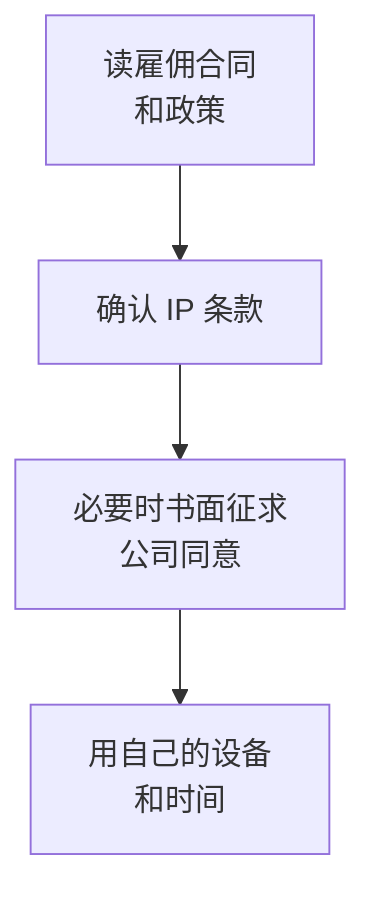

## Q
**Side projects & moonlighting · 合规与 IP**｜原则 · 追问

你想在业余时间做一个小产品，甚至接一点外包。你的雇佣合同里有一段关于"发明"和"外部工作"的条款，你没细读。动手之前要先搞清什么？（通用提醒，不是法律建议。）

## A
**原则：** 书里鼓励做 side project 来持续学习；但动手之前要确认合同和公司政策，避免 IP 归属和利益冲突的麻烦。

**要检查的：**
1. **IP assignment（知识产权转让）条款：** 有的合同声明某些范围内你做的东西归公司。看范围：只限工作相关，还是任何发明。
2. **外部工作限制：** 是否要求事先批准，是否禁止与公司业务相近的项目。
3. **竞业或利益冲突：** 项目是否和雇主的业务竞争。

**怎么做：**
1. 读合同，不确定就问律师。
2. 需要时发书面申请："I'd like to work on a personal open-source project unrelated to our product, outside work hours. Could you confirm it's compatible with my agreement?" 留下书面答复。
3. 不用公司设备、账号、数据、时间。
4. 项目和工作无关时，保存好记录。

**常见错法：** 假设"下班时间归自己"；用公司笔记本跑项目；做了才问。

**出处：** Orosz《Guidebook》Ch.26 §3（Build side projects，仅涉及学习价值）。合规与 IP 部分没有书和官方页面作依据，这里只是通用提醒，请以自己的合同和专业意见为准
