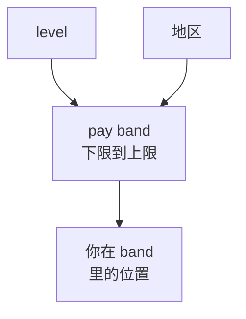

## Q
**Bands & geo adjustments · 薪酬范围与地区**｜摘要 · 追问

两个人同 level、同公司，一个在旧金山，一个在较小的城市，base 不同。公司说这是 "geo adjustment"。你在谈 offer 时怎么理解和使用这套规则？

## A
**一句话：** pay band（薪酬带）是一个 level 对应的薪酬范围；公司按地区给不同的 band。晋升会把你的薪酬移到新 band 的底部附近。

**书里的事实：**
- 晋升时，薪酬通常移到新 level band 的底部附近，最低涨幅一般 8% 到 10%。
- 书里把公司分成三档：Tier 1 本地市场、Tier 2 本地市场顶端、Tier 3 地区/国际顶端。同一岗位在不同档位可相差 2 到 4 倍。

**怎么做：**
1. 问："Could you tell me how location affects the band for this role, and which location band I'd be in?"
2. 问你在 band 的哪个位置："Where would this offer sit within the band for the level?"
3. 接 offer 后你在 band 里越靠近底部，之后涨幅越多取决于晋升。
4. 搬家或转远程之后，问薪酬是否会重新定位。

**常见错法：** 只比数字，不比 band 位置；不知道换地区会降薪；用别的城市的数据当筹码，对方的 band 不看它。

**对方在想什么：** recruiter 必须在 band 内操作，超过就要审批。你理解 band，就能把请求落在他有权限的范围。

出处

Orosz《Guidebook》Ch.4 §4（"A promotion moves compensation to the bottom of the next band"）；Ch.1 §3（tiers）。地区调整的具体规则各公司不同，需向招聘方确认

