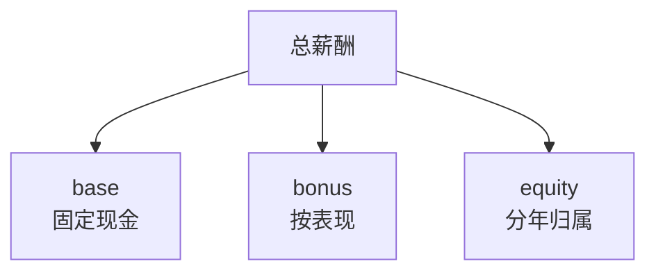

## Q
**Base, bonus, equity · 各自的性质**｜摘要 · 必会

Offer 写着"base 180k，target bonus 10%，equity 200k 四年"。三部分哪些固定、哪些有风险、哪些谈得动？

## A
**一句话：** 一份 offer 的 total compensation（总薪酬）通常是三块；它们的确定性和谈判弹性都不同。

| 部分 | 是什么 | 确定性 | 弹性 |
|---|---|---|---|
| base（底薪） | 每月固定发的现金 | 最高 | 受 pay band（该级别的底薪范围）限制，通常变动有限 |
| bonus（奖金） | 年度现金，跟个人和公司表现挂钩 | 中，target 不等于实际 | 常按 level 固定比例，可谈的空间因公司而异 |
| equity（股权） | 公司股票或期权，分多年 vest（逐步归属给你） | 最低，股价会动 | 往往是总包里最灵活的一块 |

**要点：**
- 书里的 tier 3 公司（大厂和多数中大型科技公司）通常是三块都有：base、每年发放的 equity、每年发放的现金 bonus。
- 上市公司的 equity vest 后可以卖，所以 Staff 级别的人常常 equity 一年赚得比 base 还多。
- 私有公司的 equity 不能马上变现，涨价只是账面收益，直到上市或被收购。
- 越资深，总包里 bonus 和 equity 占比越大。

**怎么做：** 先问清"target"是什么意思、过去几年实际发了多少比例。示例措辞："Could you share how the bonus payout has typically compared to target in the past two years?"

**常见错法：** 把 target bonus 当成保证；把私有公司的股权估值当成现金。

**出处：** Orosz《Guidebook》Ch.1 §3 "Compensation and Tiers of Companies"；Ch.4 §4（pay for performance）
