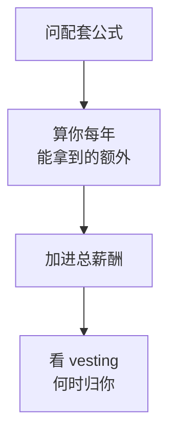

## Q
**Benefits & 401(k) match · 福利**｜摘要 · 追问

两份 offer 的现金差不多，但一家有 401(k) 公司出资，另一家没有。这个福利值多少，应该怎么算进总包？（美国通用规则，不是税务或投资建议。）

## A
**一句话：** 401(k) 是雇主的退休账户计划，你把部分工资放进账户。IRS 页面说雇主也可以往员工的账户出资。

**IRS 的通用规则（页面 2026-01-30 复核）：**
- 常规的递延（pre-tax）：存进去的钱不计入当年应税收入，退休取出时通常要交税。
- Roth 递延：先交税，满足条件的取出不再交税。
- 2026 年，员工的 401(k) 递延上限 $24,500；50 岁以上有追加额度；员工加雇主的总上限是薪酬的 100% 与 $72,000 两者中较小的（IRS 页面，2026-04-08 复核）。数字每年调整。
- "employer match"（雇主按你的出资比例配套）的具体公式，IRS 页面没有写，要看公司的计划文件。

**怎么做：**
1. 问："What's the 401(k) match formula, and when does the match vest?"（雇主出资的部分也可能有 vesting 期。）
2. 估算：假设你用满配套，每年多出多少钱，加进 total compensation。
3. 把医疗、休假、其他福利也列出来，别只比现金。

**常见错法：** 不拿满配套（等于放弃已承诺的钱）；不问 match 的 vesting。

出处

IRS https://www.irs.gov/retirement-plans/401k-plans（2026-01-30）；IRS 401(k) contribution limits 页面（2026-04-08）。通用信息，不构成建议

