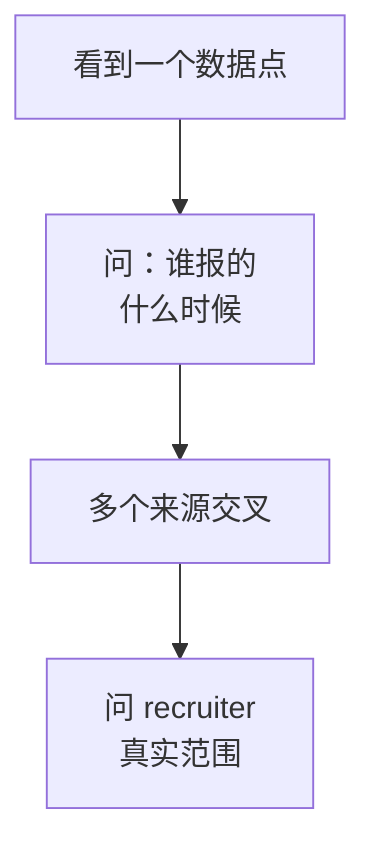

## Q
**Reading comp data · 怎么读薪酬数据**｜怎么读 · 追问

levels.fyi 上你这个 level 的中位数是 X，recruiter 的 offer 比 X 低。你能不能直接拿 X 去谈？

## A
**原则：** 薪酬数据是自报的、有样本偏差的。它给出的是范围和方向，不是公司真实的 band。

**怎么读：**
1. **谁报的：** levels.fyi 是用户自报；愿意发数据的人，薪酬往往偏高。书里的作者也是用大量自报数据分析得出分档。
2. **时间：** 数据会旧。techinterviewhandbook 的页面写明 2021 年 8 月的数字；用的时候先看日期。
3. **构成：** 比 total compensation，不是 base；看是第一年还是稳定后。
4. **level 对应：** 数据里的 level 与你拿到的未必一致（见 level mapping）。
5. **地区和公司档位：** 书里说同一岗位在不同档位可差 2 到 4 倍。
6. 交叉：多个来源；问自己圈子里的同行。

**怎么用在谈判里：** 不要说"网站上说中位数是 X"。更好的说法："Based on my research and the scope we discussed, I was expecting something closer to $X. Is there flexibility in the package?" 并问："What's the range for this level?"

**常见错法：** 把一个数据点当事实；比较时忽略 equity 的差异。

**出处：** Orosz《Guidebook》Ch.1 §3；Part V 引言（levels.fyi 的局限）；techinterviewhandbook.org/understanding-compensation/（数字为 2021 年 8 月）
