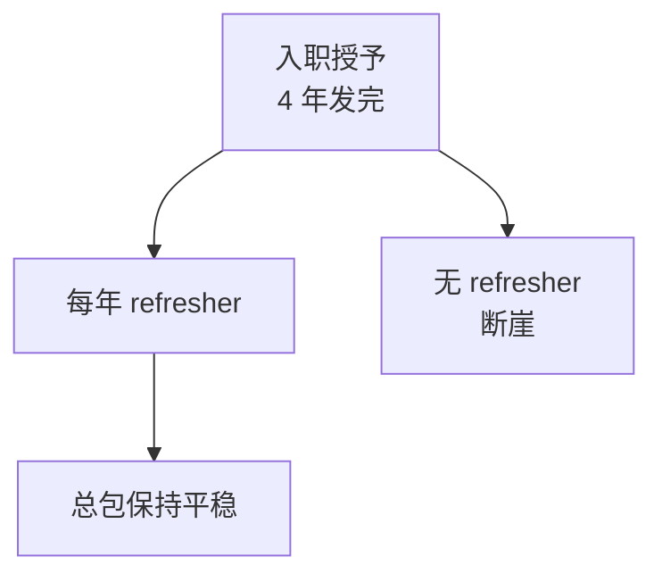

## Q
**Refreshers · 为什么重要、如何谈**｜原则 · 必会

入职第 3 年，你的 4 年 equity 快发完了。同事说："到时候看 refresher。" Refresher 是什么？为什么在谈 offer 时就要问？

## A
**原则：** refresher（年度追加的 equity 授予）决定你第 4 年之后的总包会不会断崖下降。它通常跟绩效挂钩，所以要提前问清规则。

**书里的事实（大厂）：**
- 现金 bonus 和 equity refresher 与绩效挂钩，和同级相比；最高绩效的人有时拿到平均 bonus 的 5 到 10 倍。
- 晋升后薪酬跳到新 band 的底部，最低涨幅通常 8% 到 10%，会有一部分 refresher，但常常被推迟一个周期、比期望少。
- 表现最好的人（通常占 3% 到 5%）可以比下一级的普通表现者拿得更多。

**怎么做（谈 offer 时）：**
1. 问规则。示例措辞："Could you walk me through how refreshers are determined, and what a typical refresher looks like for someone performing well at this level?"
2. 问是否所有人都有，还是只有评分在某个档位以上的人。
3. 把 refresher 视为"可能有但不保证"，比较 offer 时不要全算进去。

**常见错法：** 把 refresher 当成合同保证；入职时不问，三年后才发现没有。

**对方在想什么：** 招聘方可以讲规则，但很少会承诺金额。你问规则、不要金额承诺，更容易得到真实答复。

出处

Orosz《Guidebook》Ch.4 §4 "Promotions at Big Tech"（pay for performance、promotion moves compensation to the bottom of the next band）

