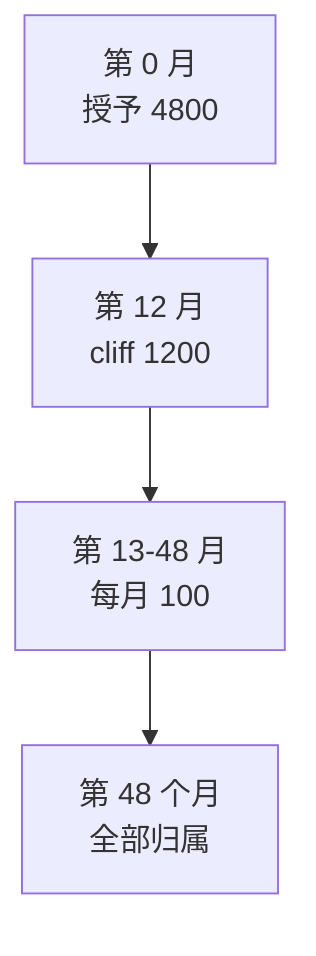

## Q
**RSUs & vesting · 归属表**｜摘要 · 必会

Offer 里写 "4,800 RSUs, 4-year vesting with a 1-year cliff, monthly thereafter"。你第 8 个月离职，一共能拿到多少股？第 18 个月呢？

## A
**定义：**
- **RSU**（restricted stock unit）：公司承诺给你一定数量的股票，按时间表归属给你。归属后股票是你的，上市公司可以在允许的窗口卖出。
- **vesting**：按时间表把这些股票一点点变成你的。
- **cliff**：最短等待期。没到 cliff 就离职，一股都拿不到。

**演算（来自 techinterviewhandbook 的例子）：**
- 1 年 cliff：到第 12 个月一次归属 1,200 股（25%）。
- 之后 3 年每月 100 股（共 3,600 股）。

| 离职时间 | 已归属 |
|---|---|
| 第 8 个月 | 0 股（还没到 cliff） |
| 第 12 个月 | 1,200 股 |
| 第 18 个月 | 1,200 + 6 × 100 = 1,800 股 |
| 第 48 个月 | 4,800 股 |

**要问的：**
1. 归属表是否均匀？有的公司前后年份比例不同（前置或后置），看 grant 文件。
2. 股价怎么算？RSU 的价值是归属时的股价，不是授予时。
3. 税：归属时通常按普通收入计税，具体看当地规则，请专业人士。

**示例措辞：** "Could you share the exact vesting schedule, including whether it's evenly spread across the four years?"

**常见错法：** 用授予日的股价把四年当成确定数字；忘了 cliff 之前走会全部作废。

**出处：** techinterviewhandbook.org/understanding-compensation/（RSU、cliff、4,800 股示例；2021 年页面，仅用作形式示意）；Orosz《Guidebook》Ch.1 §3；归属后税务见 IRS Pub. 525 "Restricted property" 一节与专业人士（不构成税务建议）
