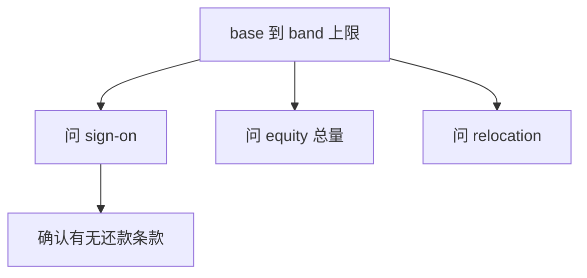

## Q
**Sign-on & relocation · 弹性最大**｜原则 · 必会

公司说 base 已经到了该级别的上限，不能再加。你还想把总包往上推。可以把注意力转向什么？

## A
**原则：** base 受 band 限制时，sign-on（入职一次性奖金）和 relocation（搬家补贴）是最容易调整的。它们是一次性的，公司批准起来比改 band 容易。

**要点：**
- sign-on 是入职时的一次性现金。techinterviewhandbook 提示：未满一年就走，可能要按比例退还，签之前读条款。
- relocation 可以部分抵销搬家成本，尤其是从国外来的时候。
- 这两项只在第一年出现。比较 offer 时，要分开写第一年和稳定后的年份。

**示例措辞（邮件）：**
"Thank you again for the offer. I'm excited about the role. Since the base is at the top of the band, would it be possible to add a sign-on bonus to bridge the gap with my other offer? If so, I'm happy to move forward quickly."

**常见错法：**
- 把 sign-on 当成永久收入。
- 忽略还款条款：入职后很快发现不合适，却要退钱。
- 只谈 sign-on，不谈 level 与 equity（后者持续多年）。

**对方在想什么：** sign-on 是一次性成本，招聘经理很清楚可以拿出来。你说明理由并设好终点（"我会尽快决定"），对方更愿意帮。

**出处：** techinterviewhandbook.org/understanding-compensation/（sign-on、relocation、还款提醒）；Kalzumeus https://www.kalzumeus.com/2012/01/23/salary-negotiation/（谈判可调的项目；做不到时换项目）
