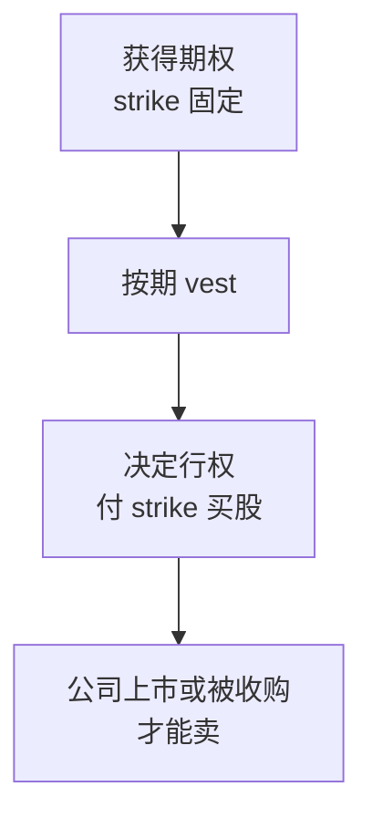

## Q
**Stock options · 行权价与税**｜摘要 · 必会

创业公司给你 20,000 份 options，strike price 是 $1.50。离职时同事提醒你"90 天内要决定"。options 到底是什么、你要想清楚哪几件事？

## A
**定义：**
- **option（期权）：** 以固定价格买公司股票的权利，不是股票本身。
- **strike price（行权价）：** 你买一股要付的固定价格。
- **exercise（行权）：** 你付钱把期权变成真股票。
- **409A valuation：** 私有公司为了税务请第三方做的普通股估值，用来定 strike price。Holloway 的指南说，员工股的 409A 价值常常只有投资人所买优先股价格的三分之一或更低。

**演算（虚构）：** strike $1.50，行权 20,000 份要付 $30,000。如果今天的 409A 估值是每股 $4，价差（spread）是 $2.50 × 20,000 = $50,000，这部分在税里有影响（见下）。

**ISO 与 NSO（美国税制，IRS Topic 427，2026-09 复核页面）：**
| | ISO（incentive stock option） | NSO（nonstatutory） |
|---|---|---|
| 授予时 | 不报收入 | 不报收入（通常无公允价） |
| 行权时 | 一般不报普通收入，但可能触发 AMT（alternative minimum tax，另一套税额计算） | 价差按普通收入报 |
| 卖出时 | 满足持有期要求为资本利得，否则按普通收入 | 资本利得 |

**要想清楚：**
1. 离职后行权窗口通常是 90 天（Holloway），很多人付不起行权款加税。
2. 早期风险：公司可能不上市，期权可能一文不值。
3. 早 exercise 并提交 83(b) election 的期限是 30 天，错过不能补（Holloway）。请专业人士。

出处

IRS Topic No. 427 https://www.irs.gov/taxtopics/tc427（页面标注 2026-09-24）；Holloway https://www.holloway.com/g/equity-compensation；Orosz《Guidebook》Ch.1 §3、Ch.5 §4。一般规则，不是税务或法律建议

