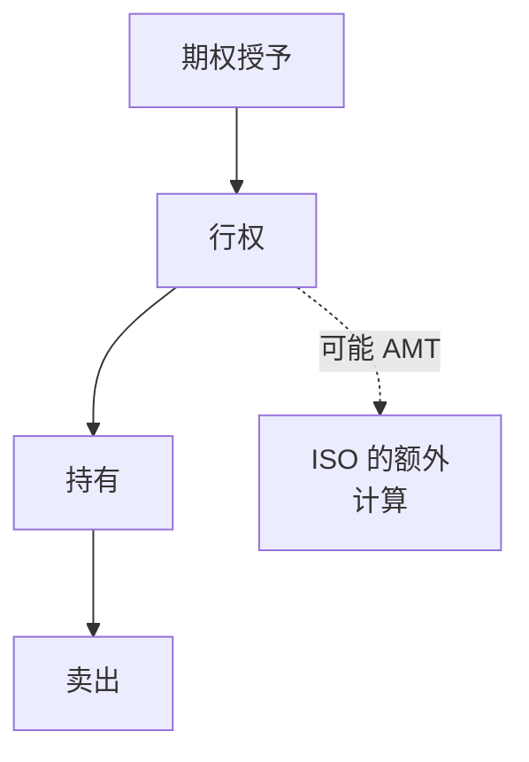

## Q
**Tax basics for comp · 通用税务常识**｜摘要 · 追问

Offer 里有 bonus 和 stock options。你想知道它们大致在什么时点被当作收入，才不会在年底被意外账单吓到。（美国通用规则，不给税率，不是税务建议。）

## A
**一句话：** 现金 bonus 拿到时是收入；期权在不同类型和不同时点有不同税务处理，要在行权前问专业人士。

| 项目 | 通用规则（IRS） |
|---|---|
| bonus | 计入收入，显示在 W-2；只是被承诺但没收到的 bonus 不算收入，直到你收到（Pub. 525，2025 版） |
| ISO | 授予和行权时一般不报普通收入，但行权可能触发 AMT；卖出时按持有期决定资本利得还是普通收入 |
| NSO（多数没有公允价的） | 授予时不征税；行权时，股票公允价减去你付的价格，计入收入；卖出时资本利得或损失 |
| 雇主表格 | ISO 行权后应收到 Form 3921；ESPP 首次转让后应收到 Form 3922 |

**怎么做：**
1. 行权前，问雇主或自己的会计："If I exercise X options this year, what is my estimated tax impact?"
2. 查官方页面：Topic 427、Form 6251 说明（AMT）、Pub. 525。
3. 把"税后实得"而不是"税前总包"放进决策。

**常见错法：** 用税前数字做大额行权决定；忽略 AMT；错过 83(b) 的 30 天期限。

**出处：** IRS Topic No. 427 https://www.irs.gov/taxtopics/tc427（2026-09-24 复核）；IRS Publication 525 (2025) "Bonuses and awards"；通用信息，不构成税务建议
